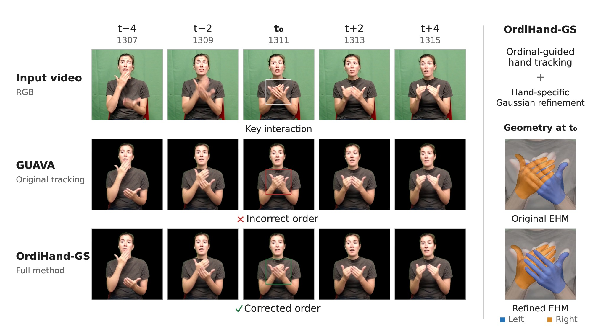

# OrdiHand-GS: Ordinal-Guided Tracking and Hand-Refined Gaussian Avatars for Digital Signers

Mingxuan Ma, Ronglai Zuo



When one hand passes in front of the other, a monocular expressive-body tracker can fit the 2D landmarks equally
well with either hand in front, and an avatar driven by that fit renders the interaction with the wrong order.
OrdiHand-GS addresses this with two parts on top of the GUAVA upper-body Gaussian avatar:

1. **Ordinal-guided tracking.** A per-frame front/back order of the two hands is read from relative depth (Video
   Depth Anything) and from apparent hand size, and the two cues are combined by a confidence-weighted vote with
   abstention. A hand-level depth hinge then imposes this order while the expressive-body fit is resumed.
2. **Hand residual head.** A small convolutional branch (221,571 parameters) predicts a local-position residual for
   the UV-space Gaussians, applied in proportion to each Gaussian's hand ownership, on top of a frozen GUAVA backbone.

## What this repository contains

Reference implementations of the three components above, in plain NumPy / OpenCV / PyTorch:

| File | Component |
|---|---|
| `ordihand/ordinal_cues.py` | relative-depth readout, apparent-size readout, confidence-weighted fusion with abstention |
| `ordihand/depth_hinge.py` | hand-level depth hinge on the fitted mesh |
| `ordihand/residual_head.py` | hand residual head, barycentric hand ownership, application of the residual |
| `tests/test_core.py` | sanity checks on synthetic inputs |

The constants in each file are the values used in the paper. Integration into a tracker or an avatar model is left
to the user: the hinge is added to the fitting objective of an expressive-body tracker such as EHM-Tracker, and the
residual head runs on the UV feature map of GUAVA's UV Gaussian decoder.

This repository does not include trained weights, annotations, evaluation data or the training and evaluation
pipeline.

```bash
pip install -r requirements.txt
python tests/test_core.py
```

## Acknowledgements

This work builds on [GUAVA](https://github.com/Pixel-Talk/GUAVA), [EHM-Tracker](https://github.com/Pixel-Talk/EHM-Tracker)
and [Video Depth Anything](https://github.com/DepthAnything/Video-Depth-Anything), and uses the
[How2Sign](https://how2sign.github.io/) dataset.

## Licence

Apache License 2.0, see `LICENSE` and `NOTICE.md`.

## Citation

The paper link and BibTeX will be added here.
